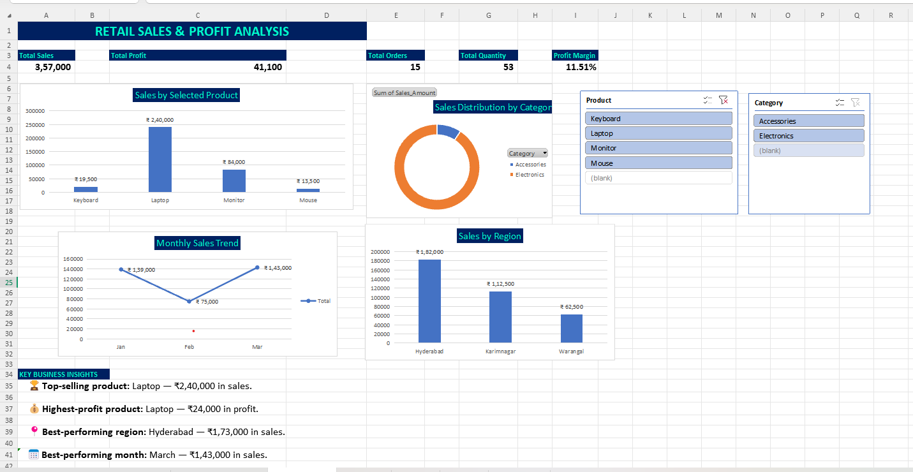

Retail Sales & Profit Analysis
Project Overview
## Dashboard Preview

This project analyzes retail sales and profitability using MySQL and Excel. It helps identify top-performing products, profitable regions, and monthly sales trends through SQL queries and an interactive dashboard.

Tools Used
MySQL
Microsoft Excel / WPS Spreadsheet
PivotTables, PivotCharts, Slicers, Conditional Formatting

Project Features
Product-wise sales and profit analysis using SQL
Region-wise sales comparison
Monthly sales trend analysis
KPI cards for total sales, total profit, total orders, total quantity, and profit margin
Interactive dashboard with product and category slicers

Key Findings
Total Sales: ₹3,57,000
Total Profit: ₹41,100
Total Orders: 15
Total Quantity Sold: 53
Overall Profit Margin: 11.51%
Top-Selling Product: Laptop
Highest-Sales Region: Hyderabad

Repository Contents
retail_analysis.sql — SQL queries for sales and profit analysis
Excel workbook — Raw data, analysis, and interactive dashboard

Future Scope
Expand the dataset with more sales records
Add advanced SQL analysis
Enhance dashboard interactivity and visualizations

Author
Vaishnavi Vardineni
